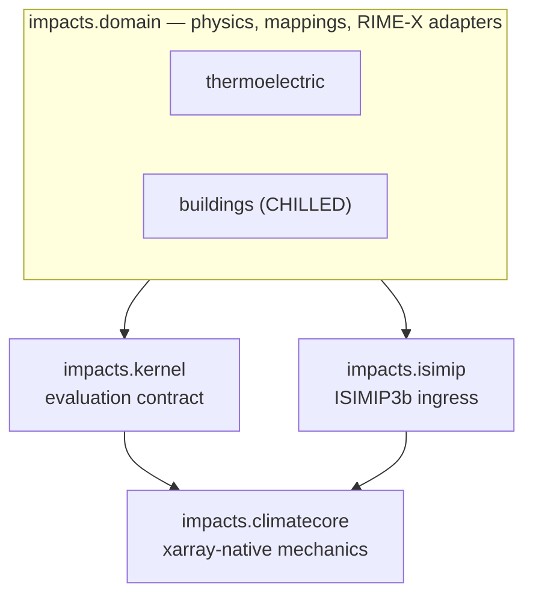
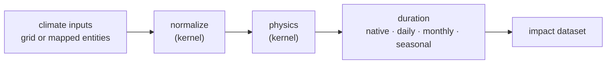

# impacts

Climate-impact kernels over a shared, xarray-native core.

`impacts` turns gridded or entity-mapped climate data into physical impact
variables — thermoelectric power-plant cooling penalties, building cooling
energy demand — through small, declarative **impact kernels** that share a
single evaluation engine. It is a library, imported as `impacts.<area>`, not a
pipeline or CLI: you compose the pieces you need into your own analysis.

## What is an impact kernel?

An impact kernel is a self-contained description of how one climate impact is
computed. Each kernel declares three things and nothing more:

- **normalize** — which climate variables it consumes and the units it needs
  them in;
- **physics** — how normalized climate is turned into impact variables;
- **metadata** — which descriptive columns are carried through to the output.

A shared engine (`impacts.kernel`) takes a kernel plus climate inputs and
evaluates it at the temporal resolution you ask for (`native`, `daily`,
`monthly`, or `seasonal`). Because the kernel describes only the physics, the
same definition runs over a regular lat/lon grid or over an arbitrary list of
mapped entities — power plants, or country × building-archetype combinations —
without changing the kernel body.

That separation — declarative physics on top, one reusable engine and a set of
xarray transforms underneath — is the organizing idea of the package.

## Install

```sh
pip install git+https://github.com/iiasa/climate-impact-kernels.git
```

For development:

```sh
git clone https://github.com/iiasa/climate-impact-kernels.git
cd climate-impact-kernels
uv sync
```

Requires Python 3.13+. The repository is named `climate-impact-kernels`; the
import package is `impacts`. Default input paths (ISIMIP forcing, CHILLED
inputs) point at the IIASA cluster mount and are overridable through
environment variables — see [docs/buildings.md](docs/buildings.md) and
[docs/thermoelectric.md](docs/thermoelectric.md).

## Usage

Every analysis has the same shape: build a kernel, then evaluate it against
climate inputs at a chosen duration. The buildings/CHILLED kernel is the
worked example (schematic — real runs need the loaders documented below):

```python
from impacts.domain.buildings.chilled import (
    ChilledEnergyAssumptions,
    create_chilled_kernel,
)
from impacts.kernel import evaluate_gridded_kernel

# A kernel is just normalization + physics; it never touches the filesystem.
kernel = create_chilled_kernel(ChilledEnergyAssumptions(...))

# Evaluate over a gridded climate dataset, aggregated to seasonal means.
result = evaluate_gridded_kernel(
    kernel,
    climate=daily_climate,        # xarray.Dataset, e.g. from impacts.isimip
    parameters=parameter_grids,   # per-cell building / setpoint parameters
    duration="seasonal",
)
```

`evaluate_mapped_kernel` is the entity-list counterpart, used when the
analytical units are intrinsically a list (power plants, or country ×
archetype) rather than a grid. Both reach the same physics. The loaders that
assemble `climate` and `parameters` are described in
[docs/buildings.md](docs/buildings.md) and [docs/workflows.md](docs/workflows.md).

## Architecture

The package is two layers, and dependencies point in one direction only:
domain physics builds on a shared core, never the reverse.



`impacts.climatecore` sits at the bottom: reusable, domain-agnostic xarray
mechanics — baselines, warming-level matching and response surfaces, region
aggregation, and temporal / spatial / unit / statistical transforms. The rule
that it must not import from any domain module, `impacts.kernel`, or
`impacts.isimip` is enforced by `import-linter`, which keeps the core
independently extractable. See [docs/architecture.md](docs/architecture.md) for
the boundary contract and the extraction recovery path.

### Evaluation flow

Within a domain, every evaluation follows the same path. The kernel supplies
the first two steps; the engine supplies the rest:



## Domains

**`impacts.domain.thermoelectric`** — thermo-electric power-plant impacts:
unit-to-grid mapping, cooling classification, wet- and dry-cooling physics
kernels, and aggregation from plant level to countries or MESSAGE R12 regions.
The derived mapping and cooling artifacts are not distributed with the
repository — they derive from license-restricted WEPP/PLATTS source data — so
regenerate them with the `build_*`/`write_*` helpers or supply your own.
Modules, artifacts, and method provenance are in
[docs/thermoelectric.md](docs/thermoelectric.md).

**`impacts.domain.buildings`** — building cooling-energy demand via the CHILLED
pathway, targeting the ALPS2025 archetype contract. The kernel (`chilled.py`)
is kept separate from its file I/O (`chilled_io.py`) and path configuration
(`chilled_config.py`) so the physics can be tested and reused independently of
the operational scaffolding. See [docs/buildings.md](docs/buildings.md).

Both domains expose **RIME-X adapters** that reshape kernel outputs into the
xarray fields consumed by [RIME-X](https://github.com/iiasa/rimeX), IIASA's
probabilistic emulator for regional climate indicators — attaching
warming-level coordinates and building quantile surfaces. The generic
warming-level attachment lives in `impacts.climatecore`; the domain adapters
(`thermoelectric/rimex.py`, `buildings/rimex.py`) add the domain-specific
reshaping.

## Documentation

- [docs/architecture.md](docs/architecture.md) — the two-layer structure and
  the `climatecore` ↓ `domain` boundary contract.
- [docs/climatecore.md](docs/climatecore.md) — the shared core's layout and
  entry points.
- [docs/thermoelectric.md](docs/thermoelectric.md) — thermoelectric modules,
  artifacts, and provenance.
- [docs/buildings.md](docs/buildings.md) — the CHILLED kernel, its inputs, and
  configuration.
- [docs/workflows.md](docs/workflows.md) — the recurring cross-module
  workflows.

## Development

```sh
uv sync                  # editable install + dev dependencies
uv run pytest            # test suite
uv run lint-imports      # verify the core / domain boundary contract
```

Tests mirror the package layout: `tests/climatecore/` for the shared core, and
`tests/test_{mapping,cooling,wet,dry,aggregation,isimip,buildings,recovery,rimex}.py`
for the domains.

## License

Apache License 2.0 — see [LICENSE](LICENSE).

## Citation

The kernels implement methods from upstream scientific work; results derived
from a kernel should cite the underlying method paper in addition to this
software:

- **CHILLED** (building cooling demand) —
  [iiasa/message-ix-buildings](https://github.com/iiasa/message-ix-buildings)
  and the references in [docs/buildings.md](docs/buildings.md).
- **Thermoelectric cooling** — Li et al. (2025) and Qin et al. (2023); see
  [docs/thermoelectric.md](docs/thermoelectric.md).
- **RIME-X** — [iiasa/rimeX](https://github.com/iiasa/rimeX).

For software-level citation, point at
<https://github.com/iiasa/climate-impact-kernels>. A formal citation entry will
be added when an `impacts`-specific paper or DOI exists.
