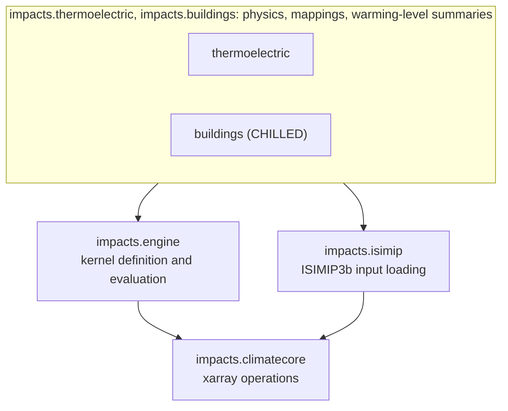
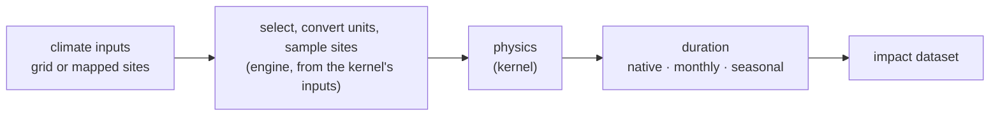

# impacts

A Python library that estimates how climate change affects thermal power plants
and building energy use. Each calculation is a kernel, and all kernels share a
core of xarray operations. Its outputs feed MESSAGE, IIASA's energy system
model.

`impacts` computes physical climate impacts from gridded climate data, or from
climate data sampled at mapped sites (rows of a mapping table, such as
power-plant units):

- the usable capacity of thermal power units under wet cooling (after Li et al.
  2025) and dry cooling (after Qin et al. 2023). Usable capacity is the share of
  a unit's rated maximum output (its nameplate capacity) that it can run at
  given its cooling-water or air limits. Wet cooling uses river or sea water;
  dry cooling uses air;
- building cooling and heating energy intensity with the CHILLED kernel (after
  Mastrucci et al. 2019 and message-ix-buildings).

It is a library, imported as `impacts.<area>`, not a pipeline.

## Impact kernels

A kernel (`impacts.engine.Kernel`) describes how one impact is computed. It
declares:

- `inputs`: the climate variables it reads and the unit each must be in;
- `site_columns`: the per-site values it carries from a mapping table (a site is
  one row of the mapping table, such as a power-plant unit, or one grid cell);
- `assumptions`: a dataclass of constants, each with a unit and a source;
- `physics(climate, sites, assumptions)`: the computation.

The engine selects and converts the inputs, samples them at the sites, runs the
physics and resamples to the requested duration (`native`, `monthly` or
`seasonal`). The same kernel runs over a regular grid (`evaluate_gridded`) or a
list of mapped sites such as power plants (`evaluate_mapped`).

## Install

```sh
pip install git+https://github.com/iiasa/climate-impact-kernels.git
```

For development:

```sh
git clone https://github.com/iiasa/climate-impact-kernels.git
cd climate-impact-kernels
uv sync
```

Requires Python 3.13+. The repository is named `climate-impact-kernels`; the
import package is `impacts`.

## Data paths

The package ships no input data and has no default data locations. Every loader
takes an explicit path; when it is omitted, the path is read from an
environment variable, and a loader with neither raises.

| Variable | Points at | Read by |
| --- | --- | --- |
| `WATXENE_DATA_PATH` | Root of the ISIMIP tree (ISIMIP is the Inter-Sectoral Impact Model Intercomparison Project; this is its bias-adjusted climate data), holding `ISIMIP/ISIMIP3b` and `ISIMIP/ISIMIP3a` in the archive's layout | `isimip3b_paths`, `isimip3a_counterclim_paths`, `reference_climate_paths` |
| `COMMON_DEFINITIONS_ROOT` | A checkout of [common-definitions](https://github.com/IAMconsortium/common-definitions) | `impacts.climatecore.regions` |
| `ALPS_DATA_PATH` | Folder with the GAUL 0.5-degree country raster and its lookup CSV, and the EWEMBI vertical and horizontal irradiance climatologies | `load_country_raster`, `load_r12_region_raster`, `load_ewembi_solar_climatology` |
| `CHILLED_ARCHETYPE_PATH` | The ALPS2025 archetype table `arch_input_reg.csv` of message-ix-buildings | `load_message_ix_buildings_archetypes` |
| `MESSAGE_R12_YAML_PATH` | The R12 (MESSAGE's twelve world regions) node definitions of message-ix-models (`data/node/R12.yaml`) | `load_r12_region_raster` |
| `CHILLED_PARAMETRIC_PATH` | A message-ix-buildings parametric-run table (`par_var.csv`); optional | `load_message_ix_buildings_parametric_runs` |
| `CHILLED_SETPOINT_PATH` | A region cooling-setpoint table; optional, see [docs/buildings.md](docs/buildings.md#region-cooling-setpoints) | `load_region_cooling_setpoints` |

The fleet tables the thermoelectric kernels read derive from a licensed source
(WEPP) and are not distributed; build them with the `build_*`/`write_*`
helpers of `impacts.thermoelectric.fleet` from your own copy.

## Usage

Evaluate a kernel against climate inputs at a chosen duration. The example is
illustrative, not runnable as written: `daily_climate` and `parameter_grids`
come from the loaders in [docs/buildings.md](docs/buildings.md).

```python
from impacts.buildings.chilled import CHILLED_KERNEL, ChilledEnergyAssumptions
from impacts.engine import evaluate_gridded

result = evaluate_gridded(
    CHILLED_KERNEL,
    climate=daily_climate,        # xarray.Dataset, e.g. from impacts.isimip
    parameters=parameter_grids,   # per-cell building / setpoint parameters
    duration="seasonal",          # aggregated to seasonal means
    assumptions=ChilledEnergyAssumptions(ac_cop=3.5),  # defaults otherwise
)  # rechunked to CHILLED_CHUNKS unless chunks= says otherwise
```

`evaluate_mapped` is the counterpart for a list of sites, such as power
plants or spatial units crossed with building archetypes (typical buildings, by
type, location class and age). [docs/workflows.md](docs/workflows.md)
shows how the loaders, kernels and aggregations are called together.

## Architecture

The package is two layers: domain physics builds on a shared core.
import-linter enforces one rule: `impacts.climatecore` does not import from the
domain packages, `impacts.engine` or `impacts.isimip`.



`impacts.climatecore` sits at the bottom: xarray operations that do not depend on
any domain, for warming-level assignment and pooling, region aggregation, and
temporal, spatial and unit transforms. It must not import from the domain modules,
`impacts.engine` or `impacts.isimip`; `import-linter` enforces this. See
[docs/architecture.md](docs/architecture.md).

### Evaluation flow

Every evaluation follows the same path:



## Domains

`impacts.thermoelectric`: thermal power-plant cooling. Unit-to-grid
mapping, cooling classification, the wet- and dry-cooling kernels, aggregation
to countries or MESSAGE R12 regions, and the methods for siting new plants. See
[docs/thermoelectric.md](docs/thermoelectric.md) and
[docs/siting.md](docs/siting.md).

`impacts.buildings`: building cooling and heating energy intensity with the
CHILLED kernel on the ALPS2025 archetypes. The kernel (`chilled.py`) is kept
apart from the code that loads its input files (`archetypes.py`) and its path
configuration (`_config.py`).
See [docs/buildings.md](docs/buildings.md).

Both domains build warming-level summaries for
[RIME-X](https://github.com/iiasa/rimeX), IIASA's emulator of regional climate
impacts by warming level. Outputs are pooled (combined before taking
statistics) over the samples in each warming-level bin and summarised per
region. A sample is one year of one GCM (global climate model) under one
scenario. A warming-level bin is the range of years whose warming is closest to
one global warming level, such as 1.5 or 2 K above pre-industrial. The
warming-level assignment and pooling live in `impacts.climatecore`; the
domain modules (`thermoelectric/warming_levels.py`,
`buildings/warming_levels.py`, `thermoelectric/siting/rime.py`) do the
domain-specific reshaping.

## Documentation

- [docs/architecture.md](docs/architecture.md): the module map and the import
  rule for `climatecore`.
- [docs/climatecore.md](docs/climatecore.md): the shared core and how
  kernels are evaluated.
- [docs/thermoelectric.md](docs/thermoelectric.md): the wet and dry kernels,
  equation by equation.
- [docs/siting.md](docs/siting.md): the methods for siting new plants.
- [docs/buildings.md](docs/buildings.md): the CHILLED kernel, equation by
  equation, and its inputs.
- [docs/assumptions.md](docs/assumptions.md): units, named constants and the
  assumptions register.
- [docs/workflows.md](docs/workflows.md): how the functions are called
  together.

## Development

```sh
uv sync                  # editable install + dev dependencies
uv run pytest            # test suite
uv run lint-imports      # check that climatecore imports nothing from the domains
```

The tests mirror the package: `tests/climatecore/`, `tests/thermoelectric/`
(with `siting/`) and `tests/buildings/` hold a file per module, and
`tests/test_isimip.py` and `tests/test_engine.py` cover the two top-level modules.
`tests/regression/` holds end-to-end tests: they run the library on small
made-up inputs and compare each result with a stored copy of an earlier result;
see its [README](tests/regression/README.md).

## License

Apache License 2.0; see [LICENSE](LICENSE).

## Citation

The kernels implement methods from upstream scientific work; results derived
from a kernel should cite the underlying method paper in addition to this
software:

- CHILLED (building cooling demand): Mastrucci et al. (2019); see
  [docs/buildings.md](docs/buildings.md). The kernel code is adapted from
  [iiasa/message-ix-buildings](https://github.com/iiasa/message-ix-buildings)
  (Apache License 2.0).
- Thermoelectric cooling: Li et al. (2025),
  <https://doi.org/10.1038/s41893-025-01692-9>, for wet cooling, and Qin et al.
  (2023), <https://doi.org/10.1038/s44221-023-00120-6>, for dry cooling; see
  [docs/thermoelectric.md](docs/thermoelectric.md). The wet-cooling code is
  adapted from the authors' released code, Li & Qin,
  <https://doi.org/10.5281/zenodo.17369544> (CC BY 4.0).
- RIME-X: [iiasa/rimeX](https://github.com/iiasa/rimeX).

For the software, cite <https://github.com/iiasa/climate-impact-kernels>.
